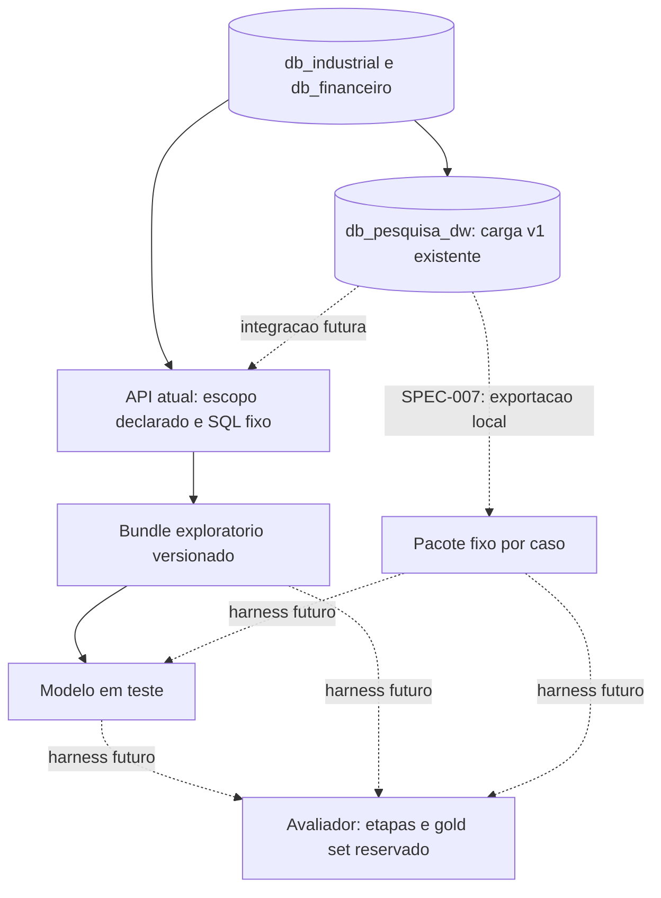
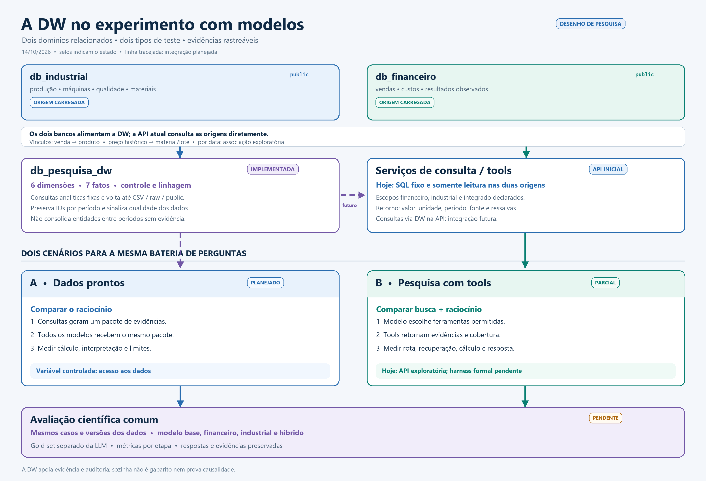

# Arquitetura proposta para consulta e avaliacao dos modelos

Status em 14/10/2026, sobre `ad6edcb` e mudancas locais sem commit: arquitetura do harness ainda em planejamento. O [DW local v1](../dw/README.md) da SPEC-006 foi implementado e carregado separadamente, mas sua revisao independente permanece pendente. Ele nao alimenta a API exploratoria nem comprova avaliacao cientifica. A [SPEC-007](../../specs/active/SPEC-007/SPEC.md) define a futura exportacao de pacotes fixos; nao implementa o harness.

## Objetivo e escopo

Comparar o modelo base, os modelos ajustados para financeiro, industrial e hibrido, e eventualmente modelos externos, usando perguntas sobre as bases simuladas. O mesmo harness deve executar casos financeiros, industriais e integrados, registrar evidencias e separar erros de recuperacao, calculo e resposta.

O harness consumira os modelos por uma interface de API padronizada, tanto os modelos hospedados quanto eventuais servicos externos. A topologia da primeira inferencia compartilhada foi [definida separadamente](../../docs/arquitetura_inferencia_compartilhada.md): backend e bancos no notebook, modelos servidos por vLLM na RunPod e front via ngrok. A primeira API HTTP local ja existe em [`inference_api/`](../../inference_api/README.md), com duas consultas exploratorias; os adaptadores de provedores externos e o harness formal ainda nao foram implementados. O serving remoto e a exposicao via ngrok tambem nao foram validados. Os CSVs originais permanecem como fonte preservada; os bancos relacionais de cada dominio sao a fonte de consulta tipada. O esquema DW antigo foi retirado do codigo ativo. O banco local `db_datamind_dw` preexistente permanece intocado e nao representa um DW validado. O novo banco `db_pesquisa_dw` contem a [primeira camada analitica rastreavel](../dw/README.md), sem integracao ao backend/harness.

## Fluxo atual e extensoes previstas

O desenho nao exige um agente LLM para cada dominio. Na cadeia exploratoria da SPEC-001, os servicos financeiro e industrial sao modulos deterministas de consulta e o escopo e declarado pelo pesquisador, sem classificador automatico. O modelo selecionado formula a resposta. A avaliacao formal fica fora do caminho de resposta ao usuario, para que o gabarito nao vaze para o modelo em teste.

O front compartilhado permite alterar prompts e selecionar modelos para exploracao, registrando um snapshot por execucao. Esses testes interativos nao recebem automaticamente o status de avaliacao cientifica. O harness formal usara casos, gold set e protocolo versionados, sem enviar o gabarito ao modelo.

## Dois cenarios de comparacao

O usuario quer avaliar os modelos em aplicacoes diferentes: uma com ferramentas de pesquisa e outra com dados ja preparados para comparar raciocinios. Esses cenarios respondem perguntas cientificas diferentes e precisam de resultados separados. O mesmo caso pode participar dos dois quando a pergunta, a versao dos dados e a evidencia esperada forem comparaveis; a pontuacao de um cenario nao substitui a do outro.

| Cenario | Entrada do modelo | O que se mede | Estado em 14/10/2026 |
| --- | --- | --- | --- |
| A. Evidencia fixa | Mesma pergunta e mesmo pacote imutavel de evidencias para cada modelo no caso | Calculo, interpretacao, sustentacao e comunicacao dos limites, dado o mesmo contexto | DW e consultas fixas existem; exportador de pacotes e harness ainda nao existem. |
| B. Pesquisa com tools | Mesma pergunta e mesmo catalogo, contratos, limites e dados disponiveis; o modelo deve obter a evidencia | Escolha de ferramenta/rota, recuperacao, calculo e resposta, com falhas por etapa | A API atual executa duas tools por escopo **declarado pelo pesquisador**. Escolha autonoma de tool pelo modelo e harness ainda nao existem. |

No cenario A, o backend/gerador consulta fontes permitidas ou a DW antes da chamada e congela o pacote. Cada modelo recebe exatamente os mesmos bytes de pergunta, evidencias e instrucoes comuns do caso; variacoes de prompt especificas de um experimento devem ser registradas como outra condicao, nunca misturadas na mesma comparacao. O pacote expõe valores, unidades, formulas, periodo, granularidade, cobertura, chaves de origem e ressalvas. Ele nao contem resposta esperada, rubrica ou gold set.

No cenario B, uma futura interface de tools permitira ao modelo solicitar consultas durante a execucao. O backend validara nome, parametros, quantidade de chamadas, timeout e tamanho de resultado, executara somente SQL fixo em transacao de leitura e registrara cada pedido e retorno. Erro de escolha, ausencia de consulta, falha de recuperacao, erro numerico e conclusao indevida serao classificados separadamente. A API atual nao satisfaz esse modo: seu `route_plan` vem do escopo informado pelo pesquisador; portanto, nao se pode pontuar sua rota atual como escolha autonoma da LLM. O protocolo exato de chamada de tools, numero de rodadas e orcamento exige SPEC propria antes da implementacao.

### Regra de comparabilidade

Cada execucao formal deve fixar `case_id`, versao do caso e do protocolo, fingerprint dos CSVs/DW, versao das consultas e do schema de evidencias, pergunta, escopo, modelo/base/adapter e hashes efetivos, prompt, parametros de geracao, limite de contexto e, no cenario B, catalogo/parametros/limites das tools. Guardar o pacote entregue, chamadas e respostas brutas, erros, timestamps e verificacoes como snapshot imutavel. Um alias do catalogo sem modelo servido ou sem proveniencia de pesos verificada nao comprova comparabilidade entre execucoes.

O recorte de perguntas deve incluir financeiro, industrial e integrado, alem de evidencia suficiente, ausente e contraditoria. Para a mesma pergunta, o cenario A isola principalmente a resposta sobre evidencias dadas; o cenario B mede tambem a obtencao delas. Resultados devem ser estratificados por cenario, dominio e tipo de falha. Uma media unica que misture A e B esconderia se o erro veio da busca ou do raciocinio. O gold set fica em armazenamento e processo separados dos payloads enviados ao modelo, com revisao humana das regras de interpretacao.

### Papel da DW e continuidade entre as bases

A DW v1 fornece uma camada analitica rastreavel, consultas fixas e flags; ela pode preparar pacotes do cenario A e ser uma fonte futura para tools do cenario B. O modelo recebe resultados de consultas por contrato, sem credencial ou SQL livre. A API atual continua consultando `db_industrial` e `db_financeiro` diretamente. Trocar essa fonte por `db_pesquisa_dw` exige reconciliar cada consulta e versionar o contrato; resultados antigos nao serao reescritos.

As cinco consultas atuais da DW informam tabelas, filtros, grao e formulas, mas um agregado nao enumera todos os IDs das linhas contribuintes. `trace` oferece linhagem de uma linha de fato identificada. O relatorio `verify` fornece flags globais da carga; uma flag global nao deve ser atribuida automaticamente a um item de um caso. O futuro pacote deve preservar essa distincao entre proveniencia da consulta, resumo global de qualidade e linhagem por registro.

Os tres indices de importacao representam particoes, nao uma identidade historica consolidada. A venda se liga ao produto e o preco historico ao material/lote pelas chaves mapeadas; resultados financeiros nao se ligam diretamente a ordem, produto ou maquina. Perguntas que exigem uma continuidade de entidade entre particoes precisam de uma tabela de correspondencia com criterio e evidencia revisados. Ate la, comparar por nome ou por janela temporal e apenas exploratorio. A DW nao corrige anomalias das fontes nem constitui gabarito.

### Sequencia de implementacao e gates

1. **Reconciliar as bases:** a revisao independente da SPEC-001 foi aprovada em 14/10/2026; concluir a da SPEC-006 e manter ambas distintas de aprovacao cientifica. A SPEC-007 podera ser implementada como preparacao local, mas seus pacotes nao viram casos oficiais antes da revisao da DW.
2. **Preparar evidencia fixa:** a [SPEC-007](../../specs/active/SPEC-007/SPEC.md) define um exportador local somente leitura, formato versionado e hashes para pacotes do cenario A. Testes com fixtures devem cobrir reproducibilidade, falta de dado, flags e ausencia de gold no pacote. Nenhum modelo e chamado nessa etapa.
3. **Definir casos e gabaritos:** selecionar perguntas e recortes, escrever calculos e tolerancias verificaveis, rubricar interpretacoes aceitaveis e revisar por humano. O conteudo oficial, tamanho da bateria e regras de pontuacao ainda precisam de contrato cientifico proprio.
4. **Implementar o harness:** consumir pacotes fixos no cenario A e definir a interface de tools do cenario B em SPECs posteriores. Reusar a API de modelos quando sua proveniencia estiver conferida; comparar primeiro com fixtures/mock, depois executar cada modelo sob o mesmo protocolo. Persistir passos e falhas por etapa.
5. **Validar a execucao real:** verificar serving e hashes dos modelos, leituras somente leitura, snapshots, isolamento de gold set e repeticao de casos. RunPod/ngrok exigem acionamento explicito da sessao; a interface exploratoria nao gera metricas do artigo por si.

Pontos que ainda exigem decisao antes de marcar o harness como `ready`: selecao e quantidade de casos por categoria; tolerancias e rubrica oficial; interface de tool-call suportada pelo serving real; limite de rodadas/chamadas; politica para modelos incapazes de usar tools; tratamento estatistico de variacao entre repeticoes. Essas decisoes nao sao preenchidas pelo DW nem pela SPEC-007.

## Responsabilidades

| Componente | Responsabilidade inicial |
| --- | --- |
| Orquestrador | Na primeira cadeia, validar escopo declarado como financeiro, industrial ou integrado, escolher consultas anuais permitidas e registrar a origem da escolha. Classificacao automatica permanece futura. |
| Servico financeiro | Na primeira cadeia, somar vendas anuais disponiveis e devolver origem, formula e filtros; outros indicadores dependem de contrato posterior. |
| Servico industrial | Na primeira cadeia, somar registros anuais de operacao e devolver origem, formula e filtros; consultas de maquinas e paradas dependem de contrato posterior. |
| Camada analitica / DW local v1 | Sete fatos detalhados, dimensoes por particao, linhagem raw/public, flags e cinco consultas fixas. Existe em `db_pesquisa_dw`; ainda nao e dependencia da primeira API. |
| Montador de contexto | Entregar ao modelo apenas evidencias pertinentes a pergunta, com valores, unidades, periodos e ressalvas. |
| Modelo em teste | Interpretar as evidencias e responder com os dados que sustentam a conclusao. |
| Harness | Executar casos e modelos sob protocolo comparavel; guardar consulta, evidencias, resposta e metricas por etapa. |
| Verificador exploratorio / avaliador futuro | O verificador local confere schema, presenca de evidencia, citacoes e estado de resposta; numeros e causalidade ficam `not_checked`. O avaliador do harness futuro comparara com gold set e rubrica fora do caminho da LLM. |

## Relacao entre as bases

Existem referencias de vendas a produtos e de custos historicos a materiais/lotes. Nem todos os resultados financeiros estao vinculados diretamente a ordem, lote ou maquina. Portanto, perguntas que combinam paradas, producao e resultados financeiros podem usar janelas temporais e outras dimensoes justificadas para **investigar associacoes**. Coincidencia temporal, por si so, nao prova causalidade nem autoriza atribuir um valor financeiro a uma maquina.

O [contrato da SPEC-006](../../specs/active/SPEC-006/SPEC.md) definiu perguntas, grao, dimensoes, janela anual, regras de agregacao, proveniencia e flags da primeira versao do DW. Sua carga local permite voltar das tabelas de fatos ao arquivo CSV, a `raw_pN` e a `public` por ID original/periodo. A comparacao temporal e exploratoria; a chave de produto liga vendas ao cadastro industrial do mesmo indice de importacao, mas nao a ordem ou maquina. Resultado financeiro nao tem chave de produto/maquina e tem lacunas de cobertura. Nao preencher chaves ausentes com vinculos aleatorios para produzir uma causalidade artificial. Cenarios simulados com mecanismo causal conhecido podem ser criados separadamente caso se queira medir deteccao de causa.

## Gold set em camadas

Cada caso pertence a uma categoria: **financeiro**, **industrial** ou **integrado**. Alem da pergunta e do recorte de dados, o caso registra:

1. **Rota esperada:** dominios e consultas necessarios.
2. **Evidencias esperadas:** registros, indicadores, periodo e fontes pertinentes; inclusive casos de evidencia insuficiente ou contraditoria.
3. **Calculos esperados:** numeros e tolerancias definidos fora da LLM.
4. **Interpretacao aceitavel:** afirmacoes sustentadas, incertezas e inferencias indevidas.
5. **Resposta esperada:** criterios de completude, citacao dos dados e clareza; pode admitir varias formulacoes corretas.

Exemplo *ilustrativo, nao extraido da base*: se uma maquina para durante uma semana, a producao cai de 1.000 para 800 unidades e a receita de 100.000 para 90.000, o gabarito exige buscar os registros dos dois dominios e calcular quedas de 20% e 10%. A resposta pode apontar associacao no periodo, mas nao afirmar que a parada causou a queda de receita sem evidencia adicional.

O harness deve avaliar todos os modelos nas tres categorias. Alem da resposta final, deve medir separadamente acerto da rota, recuperacao de evidencias, exatidao numerica e sustentacao da conclusao. Dados desorganizados permanecem na simulacao e podem compor uma faixa de robustez, distinta dos casos com gabarito inequivoco.

## Classificadores e juiz opcionais

Um classificador como Jev pode ser testado **apos a recuperacao**, sobre um pacote de evidencias ja resumido, para rotular relevancia, suficiencia ou conflito. Tambem pode ser testado na triagem da pergunta. Ele nao substitui SQL, calculos ou o modelo que redige a resposta. Nao ha decisao de inclui-lo na primeira versao: comparar o fluxo com e sem essa etapa em casos rotulados e medir ganho de selecao/contexto e custo.

Um juiz baseado em LLM pode auxiliar a avaliar se a resposta atende a pergunta, usa as evidencias e comunica limites. Ele nao valida sozinho a veracidade dos numeros. A checagem numerica e de registros usa consultas/regras deterministicas; a rubrica do juiz requer amostragem e revisao humana.

## Proximas definicoes

- Ampliar o DW somente com novas perguntas, regras de grao/agregacao e migracao explicitamente versionadas; a v1 implementa o recorte da SPEC-006.
- Integrar consultas do DW ao backend apenas com contrato de evidencia e testes proprios, sem mudar implicitamente as duas consultas atuais.
- Definir o esquema versionado do caso de teste, do pacote de evidencias e das saidas dos modelos.
- Construir um pequeno gold set auditavel para cada categoria e casos de evidencia insuficiente.
- Fixar protocolo de comparacao: mesmo recorte de dados, consultas, contexto, parametros e versao de cada modelo.
- Validar recuperacao e calculos antes de atribuir diferencas de resposta ao fine-tuning.
