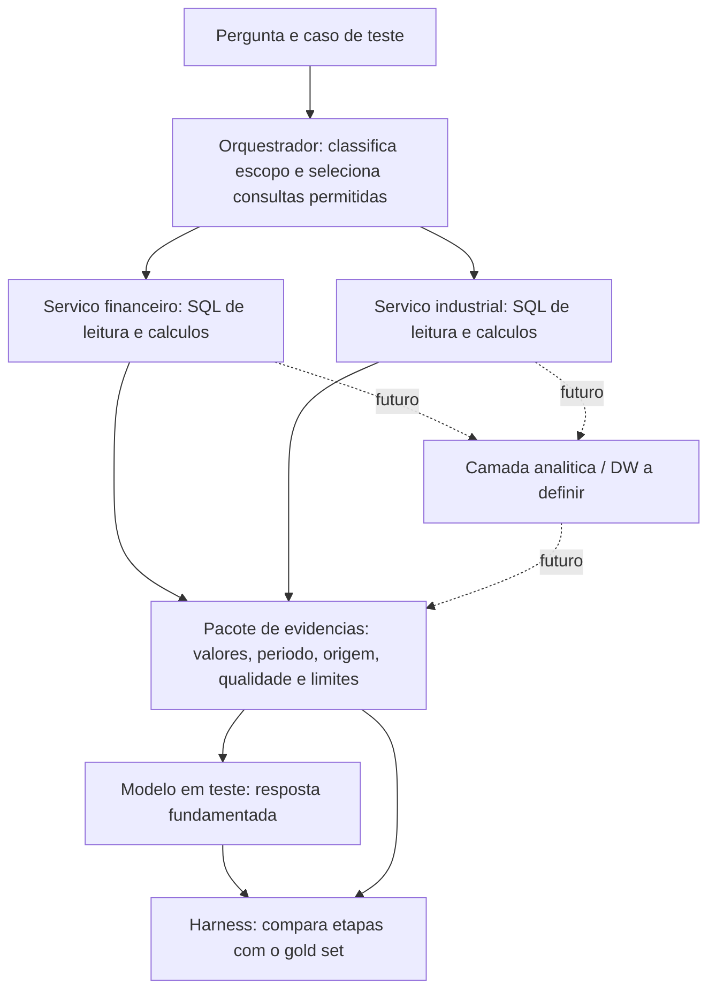

# Arquitetura proposta para consulta e avaliacao dos modelos

Status: decisoes iniciais para planejamento; nao descreve uma implementacao pronta.

## Objetivo e escopo

Comparar o modelo base, os modelos ajustados para financeiro, industrial e hibrido, e eventualmente modelos externos, usando perguntas sobre as bases simuladas. O mesmo harness deve executar casos financeiros, industriais e integrados, registrar evidencias e separar erros de recuperacao, calculo e resposta.

O harness consumira os modelos por uma interface de API padronizada, tanto os modelos hospedados quanto eventuais servicos externos. A topologia da primeira inferencia compartilhada foi [definida separadamente](../../docs/arquitetura_inferencia_compartilhada.md): backend e bancos no notebook, modelos servidos por vLLM na RunPod e front via ngrok. O contrato HTTP da aplicacao, os adaptadores de provedores externos e o harness formal ainda nao foram implementados. Os CSVs originais permanecem como fonte preservada; os bancos relacionais de cada dominio sao a fonte de consulta tipada. O esquema DW antigo foi retirado do codigo ativo. O banco local `db_datamind_dw` preexistente permanece intocado e nao representa um DW validado; o novo desenho e a carga ainda dependem de estudo.

## Fluxo previsto

O desenho nao exige um agente LLM para cada dominio. Os servicos financeiro e industrial podem ser modulos deterministas de consulta. O modelo avaliado e o responsavel por formular a resposta. A avaliacao fica fora do caminho de resposta ao usuario, para que o gabarito nao vaze para o modelo em teste.

O front compartilhado permite alterar prompts e selecionar modelos para exploracao, registrando um snapshot por execucao. Esses testes interativos nao recebem automaticamente o status de avaliacao cientifica. O harness formal usara casos, gold set e protocolo versionados, sem enviar o gabarito ao modelo.

## Responsabilidades

| Componente | Responsabilidade inicial |
| --- | --- |
| Orquestrador | Classificar a pergunta como financeira, industrial ou integrada; escolher consultas e janela temporal dentre opcoes permitidas; registrar a rota. |
| Servico financeiro | Consultar registros e indicadores financeiros, calcular valores necessarios e devolver origem e filtros usados. |
| Servico industrial | Consultar producao, operacoes, maquinas, paradas e outros registros pertinentes; calcular valores necessarios e devolver origem e filtros usados. |
| Camada analitica / DW futura | Oferecer fatos detalhados rastreaveis e visoes agregadas; preservar granularidade, proveniencia e sinalizacao de qualidade. Nao e dependencia da primeira API; seu desenho exato ainda depende de estudo. |
| Montador de contexto | Entregar ao modelo apenas evidencias pertinentes a pergunta, com valores, unidades, periodos e ressalvas. |
| Modelo em teste | Interpretar as evidencias e responder com os dados que sustentam a conclusao. |
| Harness | Executar casos e modelos sob protocolo comparavel; guardar consulta, evidencias, resposta e metricas por etapa. |
| Avaliador | Conferir rotas, evidencias e numeros por regras deterministicas; avaliar explicacao com rubrica e revisao humana quando necessario. |

## Relacao entre as bases

Existem referencias de vendas a produtos e de custos historicos a materiais/lotes. Nem todos os resultados financeiros estao vinculados diretamente a ordem, lote ou maquina. Portanto, perguntas que combinam paradas, producao e resultados financeiros podem usar janelas temporais e outras dimensoes justificadas para **investigar associacoes**. Coincidencia temporal, por si so, nao prova causalidade nem autoriza atribuir um valor financeiro a uma maquina.

O DW deve permitir consultar agregados e voltar aos registros de origem. Antes de implementa-lo, definir as perguntas analiticas, o grao de cada fato, as dimensoes compartilhadas, janelas de tempo, regras de agregacao, proveniencia e tratamento das inconsistencias conhecidas. Nao preencher chaves ausentes com vinculos aleatorios para produzir uma causalidade artificial. Cenários simulados com mecanismo causal conhecido podem ser criados separadamente caso se queira medir deteccao de causa.

## Gold set em camadas

Cada caso pertence a uma categoria: **financeiro**, **industrial** ou **integrado**. Alem da pergunta e do recorte de dados, o caso registra:

1. **Rota esperada:** dominios e consultas necessarios.
2. **Evidencias esperadas:** registros, indicadores, periodo e fontes pertinentes; inclusive casos de evidencia insuficiente ou contraditoria.
3. **Calculos esperados:** numeros e tolerancias definidos fora da LLM.
4. **Interpretacao aceitavel:** afirmacoes sustentadas, incertezas e inferencias indevidas.
5. **Resposta esperada:** criterios de completude, citacao dos dados e clareza; pode admitir varias formulacoes corretas.

Exemplo *ilustrativo, nao extraido da base*: se uma maquina para durante uma semana, a producao cai de 1.000 para 800 unidades e a receita de 100.000 para 90.000, o gabarito exige buscar os registros dos dois dominios e calcular quedas de 20% e 10%. A resposta pode apontar associacao no periodo, mas nao afirmar que a parada causou a queda de receita sem evidencia adicional.

O harness deve avaliar todos os modelos nas tres categorias. Alem da resposta final, deve medir separadamente acerto da rota, recuperacao de evidencias, exatidao numerica e sustentacao da conclusao. Dados desorganizados permanecem na simulacao e podem compor uma faixa de robustez, distinta dos casos com gabarito inequivoco.

## Classificadores e juiz opcionais

Um classificador como Jev pode ser testado **apos a recuperacao**, sobre um pacote de evidencias ja resumido, para rotular relevancia, suficiencia ou conflito. Tambem pode ser testado na triagem da pergunta. Ele nao substitui SQL, calculos ou o modelo que redige a resposta. Nao ha decisao de inclui-lo na primeira versao: comparar o fluxo com e sem essa etapa em casos rotulados e medir ganho de selecao/contexto e custo.

Um juiz baseado em LLM pode auxiliar a avaliar se a resposta atende a pergunta, usa as evidencias e comunica limites. Ele nao valida sozinho a veracidade dos numeros. A checagem numerica e de registros usa consultas/regras deterministicas; a rubrica do juiz requer amostragem e revisao humana.

## Proximas definicoes

- Fechar perguntas representativas e a granularidade do DW antes de criar fatos e agregados.
- Identificar quais relacoes entre dominios sao chaves existentes, regras de agregacao ou apenas hipoteses temporais.
- Definir o esquema versionado do caso de teste, do pacote de evidencias e das saidas dos modelos.
- Construir um pequeno gold set auditavel para cada categoria e casos de evidencia insuficiente.
- Fixar protocolo de comparacao: mesmo recorte de dados, consultas, contexto, parametros e versao de cada modelo.
- Validar recuperacao e calculos antes de atribuir diferencas de resposta ao fine-tuning.
