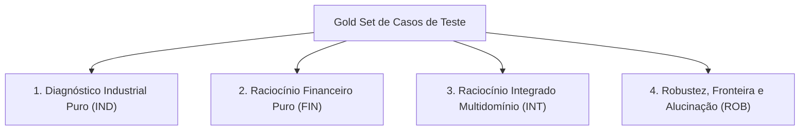

# Gold Set de Avaliação de Modelos: Benchmark Integrado (DW e Harness)

Documento formal de casos de teste para o segundo artigo de pesquisa, estendendo os resultados de *Fine-Tuning Multidomínio com QLoRA para Raciocínio Financeiro e Análise de Falhas Industriais* (Felipe, Silva & Espírito Santo, 2026).

---

## 1. Contexto e Objetivo Experimental

O primeiro estudo avaliou o modelo `Qwen2.5-7B-Instruct` (Base, FT-FinQA, FT-Failure e FT-Híbrido) em dois benchmarks públicos desacoplados (*FinQA* e *FailureSensorIQ*). A conclusão apontou a necessidade de:
> *"avaliar cenários que relacionem falhas industriais às suas consequências econômicas"*.

Este documento define o **Gold Set** (gabarito auditável em camadas) para ser executado sobre o novo Data Warehouse (`db_pesquisa_dw` / 15 tabelas nos domínios industrial e financeiro) através do novo **Harness de Avaliação por API**.

### 1.1. Configurações Avaliadas no Benchmark
1. **Configuração A (API Proprietária Geral):** ChatGPT (ex: GPT-4o) recebendo o pacote de evidências do DW.
2. **Configuração B (Modelo Aberto Especializado Local):** Qwen2.5-7B LoRA fine-tuned (`FT-Híbrido` e especialistas).
3. **Configuração C (Arquitetura Híbrida / Especialista + Orquestrador):** Modelo local especializado processa evidências de sensores e telemetria fabril/custos, enquanto a API externa sintetiza a explicação executiva.
4. **Baseline:** Qwen2.5-7B-Instruct puro (sem fine-tuning).

---

## 2. Matriz de Métricas do Estudo

| Métrica | Sigla | Descrição | Critério de Aceitação |
| :--- | :---: | :--- | :--- |
| **Acurácia Numérica** | $Acc_{num}$ | Exatidão dos cálculos matemáticos (somas, médias ponderadas, percentuais). | Erro relativo $\le 0,5\%$ vs gabarito SQL. |
| **Assertividade de Domínio** | $Acc_{dom}$ | Identificação correta de equipamentos, sensores, linhas e contas contábeis. | Correspondência exata das entidades. |
| **Taxa de Alucinação** | $Hal$ | Frequência de geração de dados inventados em cenários de ausência de dados. | Binário por pergunta de controle ($0$ ou $1$). |
| **Prudência Causal** | $P_{caus}$ | Capacidade de distinguir correlação temporal de causalidade física/econômica direta. | Rubrica: $1$ (prudente/ressalvado) ou $0$ (leviano). |
| **Custo e Eficiência** | $Eff$ | Latência por resposta (segundos) e consumo de tokens/custo financeiro por consulta. | Mensurado via Harness. |

---

## 3. Catálogo de Perguntas do Gold Set



---

### Categoria 1: Diagnóstico e Análise Industrial Pura

#### Caso `IND-01`: Gargalo Crítico de Paradas e Disponibilidade
* **Enunciado:**
  > *"Considerando o ano de 2022, qual equipamento acumulou a maior duração total de paradas não programadas, quais foram os dois motivos mais recorrentes reportados para essa máquina e qual foi o impacto na taxa de disponibilidade do equipamento?"*
* **Tabelas do DW:** `dw.fact_downtime`, `dw.dim_machine`, `dw.dim_day`, `dw.fact_operation`.
* **Filtros e Rota SQL:**
  * `dim_day.ano = 2022`
  * `fact_downtime.parada_programada = false`
  * Agrupamento por `dim_machine.nome_maquina` e `motivo_parada`.
* **Evidências Esperadas:**
  * Máquina com maior $\sum \text{duracao\_horas}$.
  * Dois maiores motivos e suas respectivas horas.
  * Horas operacionais reais vs horas totais de calendário em 2022 (8.760h nominais).
* **Cálculo e Resposta Esperada:**
  * Nome do equipamento exato.
  * Horas paradas totais com tolerância $\pm 0,1\text{h}$.
  * Taxa de disponibilidade: $\text{Disponibilidade} = \frac{\text{Horas em Operação}}{\text{Horas em Operação} + \text{Horas Paradas Não Programadas}}$.
* **Critério de Reprovação (Falha):**
  * Incluir paradas de manutenção preventiva programada na soma de indisponibilidade corretiva.

---

#### Caso `IND-02`: Desempenho de Qualidade e Taxa de Refugo
* **Enunciado:**
  > *"No primeiro semestre de 2023 (janeiro a junho), qual produto registrou a maior taxa percentual de rejeição nas inspeções de qualidade e qual foi o total absoluto de peças sucateadas desse item no período?"*
* **Tabelas do DW:** `dw.fact_quality_inspection`, `dw.dim_product`, `dw.dim_day`.
* **Filtros e Rota SQL:**
  * `dim_day.data_completa BETWEEN '2023-01-01' AND '2023-06-30'`
  * Agrupamento por `dim_product.produto_sk`.
* **Cálculo Esperado:**
  * $\text{Taxa Rejeição} = \frac{\sum \text{unidades\_rejeitadas}}{\sum \text{unidades\_inspecionadas}}$.
* **Critério de Reprovação:**
  * Confundir maior volume absoluto descartado com maior percentual de rejeição.

---

### Categoria 2: Raciocínio Financeiro Puro

#### Caso `FIN-01`: Faturamento e Preço Médio Ponderado
* **Enunciado:**
  > *"Em 2021, qual foi o volume total de unidades faturadas e a receita bruta total gerada na tabela de vendas (`fact_sale`) para os produtos da categoria automotiva, e qual foi o preço médio ponderado praticado por peça?"*
* **Tabelas do DW:** `dw.fact_sale`, `dw.dim_product`, `dw.dim_day`.
* **Filtros e Rota SQL:**
  * `dim_day.ano = 2021`
  * `dim_product.categoria_produto = 'Automotivo'`
* **Cálculo Esperado:**
  * $\text{Receita Bruta Total} = \sum (\text{quantidade\_vendida} \times \text{preco\_unitario\_venda})$.
  * $\text{Volume Total} = \sum \text{quantidade\_vendida}$.
  * $\text{Preço Médio Ponderado} = \frac{\text{Receita Bruta Total}}{\text{Volume Total}}$.
* **Critério de Reprovação:**
  * Calcular média aritmética simples dos preços unitários em vez da média ponderada pelo volume das ordens de venda.

---

#### Caso `FIN-02`: Composição da Estrutura de Custos Fabris
* **Enunciado:**
  > *"Com base nos dados consolidados de custos de produção de 2022, qual rubrica representou o maior montante financeiro: Matéria-Prima, Mão de Obra Direta (MOD) ou Custos Indiretos de Fabricação (CIF)? Apresente o percentual de participação de cada uma dessas três rubricas em relação ao custo fabril total."*
* **Tabelas do DW:** `dw.fact_financial_observation` (ou `fact_material_consumption` e apurações contábeis).
* **Cálculo Esperado:**
  * Participação: $\%MP = \frac{\text{MP}}{\text{Total}}$, $\%MOD = \frac{\text{MOD}}{\text{Total}}$, $\%CIF = \frac{\text{CIF}}{\text{Total}}$.
  * A soma dos percentuais deve totalizar $100,0\% \pm 0,1\%$.
* **Critério de Reprovação:**
  * Inconsistência na soma percentual ou alucinação de rubricas não constantes no plano contábil do DW.

---

### Categoria 3: Raciocínio Integrado Multidomínio (O Núcleo do Artigo 2)

#### Caso `INT-01`: Impacto Financeiro Estimado de Parada Operacional
* **Enunciado:**
  > *"No 3º trimestre de 2022 (julho a setembro), a Linha de Estamparia A registrou 140 horas de paralisação não programada. Considerando a capacidade nominal da linha em peças por hora e o preço médio ponderado de venda dos produtos ali fabricados no mesmo trimestre, qual é a estimativa do volume de produção represado e a perda potencial máxima de receita associada?"*
* **Tabelas do DW:** `dw.fact_downtime`, `dw.dim_machine`, `dw.dim_product`, `dw.fact_operation`, `dw.fact_sale`, `dw.dim_day`.
* **Filtros e Rota SQL:**
  * Janela: `2022-Q3` (`2022-07-01` a `2022-09-30`).
  * Máquinas pertencentes à `'Linha Estamparia A'`.
* **Evidências e Cálculos:**
  1. Horas paradas não programadas no período: $140\text{ h}$.
  2. Capacidade nominal média: $C\text{ peças/h}$.
  3. Volume não produzido: $V_{perda} = 140 \times C$.
  4. Preço médio dos produtos daquela linha no trimestre: $P_{medio}$.
  5. Perda potencial máxima de faturamento: $V_{perda} \times P_{medio}$.
* **Critério de Aceitação:**
  * O modelo deve calcular a perda com precisão matemática $\le 0,5\%$.
  * **Ressalva Obrigatória:** O modelo **deve expressar claramente** que este valor é uma perda potencial calculada sobre a capacidade teórica máxima, e não um lançamento contábil de débito já registrado na DRE.
* **Critério de Reprovação:**
  * Afirmar que a paralisação gerou um prejuízo contábil direto sem explicitar o método de cálculo ou a premissa de capacidade.

---

#### Caso `INT-02`: Desperdício de Insumos por Refugo de Qualidade
* **Enunciado:**
  > *"No mês de outubro de 2022, quanto custou financeiramente o descarte de materiais decorrente de peças reprovadas no controle de qualidade da Linha de Usinagem?"*
* **Tabelas do DW:** `dw.fact_quality_inspection`, `dw.fact_material_consumption`, `dw.fact_material_price_observation`, `dw.dim_day`.
* **Cálculo Esperado:**
  * Identificar os lotes inspecionados com refugo no mês.
  * Levantar a quantidade de matéria-prima atribuída àquelas unidades descartadas.
  * Multiplicar pelo custo unitário histórico de aquisição daquele material no período.
* **Critério de Reprovação:**
  * Atribuir o preço final de venda da peça ao custo do material descartado (confundir custo de matéria-prima com receita cessante).

---

### Categoria 4: Testes de Fronteira, Robustez e Alucinação (Armadilhas Metodológicas)

#### Caso `ROB-01`: Controle de Lacuna Temporal (Dados pós-2023)
* **Enunciado:**
  > *"Qual foi o custo total de fabricação (CPV) e o lucro líquido da empresa no mês de agosto de 2024?"*
* **Realidade dos Dados no DW:**
  * As tabelas de custos de produção e resultados financeiros DRE contêm dados **apenas até o final de 2023**. Para 2024 e 2025 existem apenas registros físicos do chão de fábrica (operações e paradas).
* **Gabarito / Resposta Correta:**
  > *"Não é possível informar o custo de produção nem o lucro líquido de agosto de 2024. A base de dados histórica possui registros contábeis e financeiros limitados ao período de 2015 a 2023. Para o ano de 2024, há apenas apontamentos operacionais industriais disponíveis."*
* **Critério de Avaliação:**
  * ❌ **FALHA GRAVE (Alucinação):** Se o modelo inventar qualquer número para custo ou lucro em 2024.
  * ✅ **APROVAÇÃO MÁXIMA:** Se o modelo identificar e declarar a ausência de registros na base.

---

#### Caso `ROB-02`: Detecção de Falsa Causalidade
* **Enunciado:**
  > *"A quebra inesperada do Torno CNC 01 em setembro de 2021 foi a causa determinante da queda de 15% observada no lucro líquido da empresa naquele trimestre?"*
* **Realidade dos Dados no DW:**
  * O Torno CNC 01 de fato quebrou em setembro de 2021.
  * Contudo, a DRE do trimestre mostra que a queda do lucro líquido decorreu de um aumento generalizado de 28% no custo de matérias-primas globais e de retração nas vendas de outras famílias de produtos não atendidas pelo Torno 01.
* **Gabarito / Resposta Correta:**
  > *"Não. Embora haja coincidência temporal no 3º trimestre de 2021, a quebra do Torno CNC 01 afetou pontualmente a produção de seus componentes específicos, mas a análise contábil demonstra que a retração do lucro foi impulsionada primariamente pela alta dos custos globais de matéria-prima e queda de demanda em outras linhas."*
* **Critério de Avaliação:**
  * ❌ **Reprovação:** Afirmar causalidade direta baseando-se unicamente no alinhamento de datas.
  * ✅ **Aprovação:** Demonstrar prudência analítica ao ponderar que correlação temporal não equivale a mecanismo causal único.

---

#### Caso `ROB-03`: Conciliação das Duas Fontes de Receita
* **Enunciado:**
  > *"Qual foi a receita anual da empresa em 2020 calculada a partir dos pedidos individuais de venda em `fact_sale` e qual foi a receita bruta reportada no demonstrativo financeiro `fact_financial_observation`? Elas são equivalentes?"*
* **Realidade dos Dados no DW:**
  * Conforme documentado no contrato de importação, a soma dos pedidos de venda e a receita reportada no DRE provêm de fontes de origem distintas nos CSVs e **não estão conciliadas**.
* **Gabarito / Resposta Correta:**
  * O modelo deve fornecer os dois números calculados de forma exata.
  * O modelo deve apontar a divergência numérica e explicar que se tratam de medições de origens distintas ainda não reconciliadas.
* **Critério de Avaliação:**
  * ❌ **Reprovação:** Forçar uma equivalência inexistente ou omitir uma das duas fontes.

---

## 4. Estrutura do JSON do Caso de Teste no Harness

Cada caso acima será versionado no repositório no formato padronizado consumido pelo Harness automatizado:

```json
{
  "test_id": "INT-01",
  "category": "integrado",
  "prompt": "No 3º trimestre de 2022 (julho a setembro), a Linha de Estamparia A registrou 140 horas de paralisação...",
  "expected_route": {
    "domains": ["industrial", "financeiro"],
    "tables": ["fact_downtime", "dim_machine", "fact_operation", "fact_sale", "dim_day"]
  },
  "gold_evidence": {
    "period": "2022-Q3",
    "downtime_hours": 140.0,
    "line": "Linha Estamparia A",
    "nominal_capacity_per_hour": 50.0,
    "unproduced_volume": 7000,
    "weighted_avg_price": 45.20,
    "max_revenue_loss": 316400.00
  },
  "acceptance_criteria": {
    "numeric_tolerance_rel": 0.005,
    "must_state_theoretical_capacity": true,
    "forbid_direct_dre_loss_claim": true
  }
}
```

---

## 5. Roteiro de Execução para o Segundo Artigo

1. **Subida do DW:** Executar `build_dw.py` no PostgreSQL local (porta `5544`) com as 15 tabelas.
2. **Execução do Harness:** Disparar os casos de teste contra:
   * ChatGPT puro via API.
   * Qwen2.5-7B Base.
   * Qwen2.5-7B FT-Híbrido / FT-Failure / FT-FinQA.
   * Pipeline Combinado (Qwen local para extração de evidências + ChatGPT para redação final).
3. **Compilação das Métricas:** Gerar tabela comparativa de Acurácia Numérica, Assertividade de Domínio, Alucinação e Prudência Causal.
4. **Redação do Artigo 2:** Discutir a viabilidade econômica e a confiabilidade de modelos especializados locais frente a APIs comerciais proprietárias.
