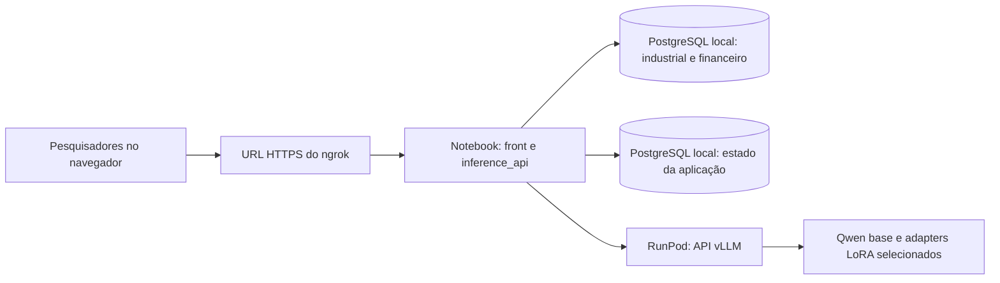

# Arquitetura da inferência compartilhada

**Estado em 15/10/2026:** arquitetura acordada, SPEC-001 e SPEC-003 implementadas e aprovadas para o escopo local. A bancada da SPEC-004 foi implementada no checkout sobre `1e8cb76`, com critérios versionados e comparação visual. Sua migração 002 passou em banco descartável e foi aplicada em `db_inference_app` após backup lógico; a interface passou em navegador com API simulada e a [revisão independente](../specs/active/SPEC-004/evidence/review.json) aprovou o escopo local. O [DW local v1](../BancoModeloUse/dw/README.md) está em outro banco e não está ligado à API. A SPEC-002 preparou serving vLLM, Terraform e [procedimento de custo e aplicação futura](../runpod/serving/README.md) apenas no checkout, com revisão independente aprovada para esse escopo. Pod, ngrok e validação compartilhada não foram executados. Este documento não comprova implantação ou teste remoto. A decisão original foi registrada no commit `ba79b36`.

## Objetivo e limites

Disponibilizar por uma sessão científica curta e compartilhada uma interface para editar prompts, escolher a LLM de inferência, ler respostas, inspecionar evidências e registrar verificações. A primeira implantação deve ser simples e de baixo custo: banco, backend e interface no notebook; GPU apenas na RunPod. O período de uso previsto é inferior a 24 horas, sem requisito de disponibilidade contínua.

O [protocolo de fine-tuning](../FineTuning/docs/protocol_v1.md), os [dados de origem](../BancoModeloUse/README.md), os [adapters e seus manifests](../FineTuning/docs/modelos_disponiveis.md) e os resultados já registrados permanecem preservados. O DW local v1 já foi implementado; sua integração ao backend e o harness formal por API continuam planejados e não são pré-requisitos implícitos para o primeiro serviço de inferência.

Para a comparação científica futura, a [arquitetura de avaliação](../BancoModeloUse/docs/arquitetura_avaliacao_modelos.md) distingue evidências fixas, iguais entre modelos, de pesquisa com tools. A [SPEC-007](../specs/active/SPEC-007/SPEC.md) prepara apenas a exportação local e reproduzível de evidências fixas a partir da DW. A API exploratória atual continua selecionando suas duas consultas por escopo declarado; escolha de tools pela LLM e pontuação formal ainda exigem contratos e implementação próprios.

## Topologia escolhida



O [mapa visual completo](assets/fluxo_arquitetura_pesquisa.png) também mostra
o DW local e distingue as ligações implementadas das previstas. O
[SVG editável](assets/fluxo_arquitetura_pesquisa.svg) preserva a fonte do desenho.

- O ngrok expõe **somente a aplicação HTTP** por uma URL HTTPS. O PostgreSQL permanece no loopback do notebook. A RunPod não precisa iniciar conexão com o notebook; o backend local faz chamadas de saída para a API do modelo. [Referência: túnel HTTP do ngrok](https://ngrok.com/use-cases/share-localhost).
- O front é servido pela mesma aplicação e pela mesma URL do ngrok. Ele chama apenas o backend local, sem receber credenciais da RunPod ou do PostgreSQL.
- O backend orquestra consultas permitidas e de leitura, monta um pacote de evidências e chama a LLM. A LLM não recebe acesso direto ao banco nem SQL arbitrário do navegador.
- O notebook, o cluster local, a aplicação, o túnel e o Pod precisam permanecer ativos durante o uso. Ao encerrar a sessão, o serviço de modelo pode ser parado para interromper o custo de GPU, observadas as regras de cobrança e armazenamento do provedor.

## Responsabilidades do código

| Frente | Responsabilidade e estado atual |
| --- | --- |
| [`BancoModeloUse/`](../BancoModeloUse/README.md) | Contém os CSVs preservados, modelos SQLAlchemy, importador e dois bancos locais `db_industrial` e `db_financeiro`. O [DW v1](../BancoModeloUse/dw/README.md) está em `db_pesquisa_dw`, separado das fontes e da aplicação. A API atual continua lendo diretamente os bancos de origem. |
| [`FineTuning/`](../FineTuning/AGENTS.md) | Continua sendo a fonte de verdade dos experimentos, configurações, adapters, manifests e resultados. Seus scripts de treino não serão executados para atender requisições do front. |
| [`runpod/`](../runpod/README.md) | Contém scripts históricos de preparação, treino e avaliação. [`runpod/serving/`](../runpod/serving/README.md) contém preparação local do vLLM, gateway protegido, verificador e Terraform; nenhum Pod foi criado. |
| [`inference_api/`](../inference_api/README.md) | HTTP local, login individual aprovado da SPEC-003, três escopos declarados sobre duas consultas fixas, bundle versionado, catálogo de aliases e cliente vLLM. A SPEC-004 acrescentou bancada responsiva, critérios versionados e comparação visual de snapshots no checkout; a migração foi aplicada no banco da aplicação e a revisão independente aprovou o escopo local. Exposição compartilhada e verificação científica seguem pendentes. |
| [Arquitetura da avaliação](../BancoModeloUse/docs/arquitetura_avaliacao_modelos.md) | Define perguntas, evidências, gold set e verificações científicas. O DW local v1 existe sob SPEC-006; integração e harness formal seguem pendentes. |

Estrutura atual e extensão prevista:

```text
inference_api/
  README.md
  web/                  # bancada local, servida pela API
  src/
    inference_api/      # HTTP, evidências, cliente vLLM, serviço e persistência
runpod/
  serving/              # manifesto, preflight, gateway, verificador e Terraform locais
```

O contrato HTTP e o esquema inicial estão descritos no [README da API](../inference_api/README.md). Não criar diretórios vazios nem reaproveitar o antigo RAG/agentes retirado do checkout. O importador atual aceita apenas o cluster isolado em `127.0.0.1:5544`; a aplicação nova exige essa configuração explícita e não usa os valores padrão `localhost:5432` de [`database_config.py`](../BancoModeloUse/infrastructure/config/database_config.py). A conexão falha se a configuração estiver ausente.

## Modelos na RunPod e troca pelo front

Os pesos disponíveis no checkout são adapters PEFT/LoRA, não cópias completas da LLM. O [catálogo de modelos](../FineTuning/docs/modelos_disponiveis.md) identifica a base `Qwen/Qwen2.5-7B-Instruct`, os seis adapters locais, suas runs e seus manifests. A versão exata dos pesos da base ainda não está fixada por hash nesse catálogo. Antes de servir, registrar a revisão efetivamente obtida da base e conferir os arquivos dos adapters escolhidos.

O [manifesto de serving](../runpod/serving/manifest.json) registra aliases, baterias, runs e hashes dos seis adapters. O preflight local recusa divergências antes de montar o comando estático do vLLM. A revisão exata da base é entrada obrigatória da sessão futura, pois não ficou registrada nos treinos históricos. O backend marca um modelo disponível somente se aparecer em `/v1/models` e marca geração confirmada apenas com recibo da mesma sessão. Ao clicar em outro modelo fine-tunado, o front muda o alias na próxima requisição; não reinicia o Pod nem altera a escolha dos demais usuários. A capacidade concreta ainda requer teste no Pod escolhido. [Referência: serving LoRA do vLLM](https://docs.vllm.ai/en/stable/features/lora/).

O comando local registra os seis adapters autorizados na inicialização. O gateway exige token e permite somente `GET /v1/models` e `POST /v1/chat/completions`; o vLLM escuta apenas no loopback do Pod. O carregamento dinâmico de LoRA permanece fora do fluxo. Uma LLM com outra base de pesos pode exigir outro processo ou endpoint; nesse caso, o backend roteará pelo catálogo, e o custo/capacidade devem ser avaliados antes de disponibilizá-la no seletor.

## Front e histórico compartilhado

O front local permite editar prompt e critérios estruturados, selecionar um alias disponível por run, executar perguntas, inspecionar histórico e comparar snapshots lado a lado. O navegador busca disponibilidade do backend e não escolhe SQL. A interface separa resposta, consulta fixa, evidência, fonte, período, unidade, checks e erro, marcando `answered_unverified` como não verificado cientificamente. A comparação avisa quando pergunta, período, evidência, prompt, critérios, parâmetros ou modelo/versão diferem; não agrega pontuação. Os testes de navegador da SPEC-004 usaram API simulada local, não o Pod nem a URL futura do ngrok.

Cada salvamento de prompt ou critério cria uma **nova revisão**; cada execução guarda um snapshot imutável com texto exato do prompt e configuração exata dos critérios, mesmo quando partiu de rascunho. O registro identifica autor autenticado, data, versões, modelo/endpoint/adapter quando confirmados, parâmetros, pergunta, rota, consultas, evidências com origem e período, resposta, verificações e estado de erro. Feedback humano fica separado do snapshot. A escolha do modelo pertence à execução de cada usuário, sem configuração global.

O armazenamento editável da aplicação usa `db_inference_app` no mesmo cluster PostgreSQL. `init-db` cria o esquema inicial; iniciar a API não altera o esquema. A migração 001 acrescentou identidade, sessões e uso. A migração explícita 002 acrescentou revisões de critérios após backup lógico, com readback das versões 1 e 2. Ambas têm SQL reverso. A política de retenção ainda não foi implementada. Os bancos de origem industrial e financeiro são consultados somente em leitura, por SQL fixo. Dados congelados, adapters, manifests e resultados brutos existentes não são editados pelo front.

Experimentos livres no front e avaliação formal têm estados distintos. Uma comparação científica exigirá um caso e protocolo versionados, mesmo recorte de dados e contexto, parâmetros declarados e verificações apropriadas. O gold set e os critérios oficiais de avaliação ficam fora do contexto entregue à LLM. A [arquitetura de avaliação](../BancoModeloUse/docs/arquitetura_avaliacao_modelos.md) continua sendo a fonte dessa separação.

## Contratos: primeira fatia e pendências

1. **Entrada e saída HTTP:** implementadas para pergunta, revisão ou rascunho, alias, parâmetros e snapshot com evidência, resposta, estado e erro. A API não aceita SQL livre. Veja o [contrato executável](../inference_api/README.md).
2. **Pacote de evidências:** contrato exploratório `schema_version: 2` para escopos declarados financeiro, industrial e integrado. A rota integrada reúne duas agregações anuais de fontes distintas, com aviso de associação sem causalidade. O verificador confere estrutura e citações; validação científica continua fora da API. Snapshots da primeira fatia (`schema_version: 1`) permanecem legíveis.
3. **Catálogo de modelos:** sete aliases candidatos do manifesto e consulta de disponibilidade em `/v1/models` implementados. Headers de uma sessão cujo manifesto coincide com o local permitem registrar revisão da base, run e hash do adapter no snapshot; um recibo da mesma sessão distingue geração confirmada. Nenhuma sessão remota foi validada. Janela efetivamente suportada e identidade da base usada no treino continuam sem prova. Segredos ficam apenas no ambiente dos processos, fora do Git.
4. **Persistência e concorrência:** esquema inicial de revisões de prompt, snapshots de execução e feedback implementado, com conflito por revisão esperada. A migração 001 de identidade foi aplicada localmente em 15/10/2026 após backup lógico e o SQL reverso foi testado em banco isolado. Novos registros usam autoria verificada no backend; registros históricos mantêm autoria declarada. A política de retenção ainda falta.
5. **Acesso compartilhado:** a SPEC-003 implementou localmente login exclusivo para Nicoli e Vinicius, sessões revogáveis e uma vaga global de inferência. Ambos podem permanecer logados; a segunda inferência simultânea recebe HTTP 429 antes de consultar fontes ou chamar a LLM. O limite diário está desativado. O front mostra teto manual informativo de US$ 10 e saldo real apenas quando a API de leitura da RunPod responde, sem transformar o teto em bloqueio de cobrança. Os [testes locais de 15/10/2026](../specs/active/SPEC-003/evidence/local-2026-10-15.md) passaram e a [revisão independente](../specs/active/SPEC-003/evidence/review.json) aprovou o escopo local; o ngrok ainda não foi aberto. O gateway remoto foi escrito com bearer token e allowlist de duas rotas; sua proteção ainda requer teste real pela URL HTTPS da RunPod. A chave nativa do vLLM não protege todos os seus endpoints. [Referência: segurança do vLLM](https://docs.vllm.ai/en/stable/serving/online_serving/openai_compatible_server/).
6. **Capacidade e operação:** Terraform e comandos de preflight/start/verificação estão preparados localmente. O [runbook](../runpod/serving/README.md) contém fórmula de custo de GPU e discos, procedimento de `plan` e sequência de implantação para outra interação. GPU/VRAM, quantização, concorrência, compatibilidade real dos seis adapters, parada/remoção externas e teste de ponta a ponta continuam pendentes. A oferta concreta da Pod não foi escolhida; `terraform apply` exige confirmação explícita do usuário após revisar plano e estimativa.

## Evidência e manutenção

Antes de dizer que o serviço está pronto, verificar separadamente: carga da base e dos adapters com seus identificadores; resposta da API do vLLM; consultas de leitura aos dois bancos locais; persistência de revisões e execuções; front pela URL do ngrok; autenticação; e uma execução ponta a ponta com proveniência legível. Um teste local ou um manifest com estado `completed` não equivale a essa validação.

Atualizar este documento e os README das frentes afetadas na mesma mudança que alterar topologia, contratos ou comandos. Marcar decisões propostas e partes ainda não implementadas; registrar data/commit e evidência para afirmações que envelhecem. Remover instruções e código comprovadamente fora de uso após conferir consumidores, preservando dados e resultados protegidos conforme o [AGENTS.md da raiz](../AGENTS.md).

Em 16/10/2026, a [SPEC-005](sessao_inferencia_curta.md) acrescentou verificações
e runbook para a sessão curta, com [revisão independente](../specs/active/SPEC-005/evidence/review.json)
aprovada no escopo local. O pré-voo lê bancos locais e valida adapters;
o teste do túnel e o ensaio com gerações exigem `--execute` e ativação
autorizada. Implementar esses comandos não constitui prova de Pod, ngrok ou
avaliação científica: cada camada precisa de seu próprio readback na sessão.
