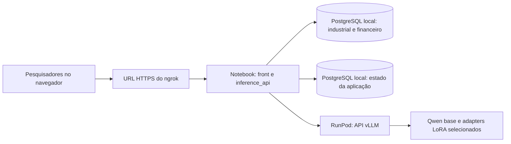

# Arquitetura da inferência compartilhada

**Estado em 12/10/2026:** direcionamento de arquitetura acordado para a próxima implementação. O serviço de inferência, o front, o serving com vLLM, o túnel ngrok e o banco da aplicação ainda não existem neste checkout. Este documento não comprova implantação ou teste remoto. Checkout consultado: `ba79b36`.

## Objetivo e limites

Disponibilizar por uma sessão científica curta e compartilhada uma interface para editar prompts, escolher a LLM de inferência, ler respostas, inspecionar evidências e registrar verificações. A primeira implantação deve ser simples e de baixo custo: banco, backend e interface no notebook; GPU apenas na RunPod. O período de uso previsto é inferior a 24 horas, sem requisito de disponibilidade contínua.

O [protocolo de fine-tuning](../FineTuning/docs/protocol_v1.md), os [dados de origem](../BancoModeloUse/README.md), os [adapters e seus manifests](../FineTuning/docs/modelos_disponiveis.md) e os resultados já registrados permanecem preservados. O novo DW e o harness formal por API continuam planejados; não são pré-requisitos implícitos para o primeiro serviço de inferência.

## Topologia escolhida



- O ngrok expõe **somente a aplicação HTTP** por uma URL HTTPS. O PostgreSQL permanece no loopback do notebook. A RunPod não precisa iniciar conexão com o notebook; o backend local faz chamadas de saída para a API do modelo. [Referência: túnel HTTP do ngrok](https://ngrok.com/use-cases/share-localhost).
- O front é servido pela mesma aplicação e pela mesma URL do ngrok. Ele chama apenas o backend local, sem receber credenciais da RunPod ou do PostgreSQL.
- O backend orquestra consultas permitidas e de leitura, monta um pacote de evidências e chama a LLM. A LLM não recebe acesso direto ao banco nem SQL arbitrário do navegador.
- O notebook, o cluster local, a aplicação, o túnel e o Pod precisam permanecer ativos durante o uso. Ao encerrar a sessão, o serviço de modelo pode ser parado para interromper o custo de GPU, observadas as regras de cobrança e armazenamento do provedor.

## Responsabilidades do código

| Frente | Responsabilidade e estado atual |
| --- | --- |
| [`BancoModeloUse/`](../BancoModeloUse/README.md) | Já contém os CSVs preservados, modelos SQLAlchemy, importador e dois bancos locais `db_industrial` e `db_financeiro`. Continua responsável pelas fontes e pela carga verificável; a nova aplicação os consultará em modo de leitura. |
| [`FineTuning/`](../FineTuning/AGENTS.md) | Continua sendo a fonte de verdade dos experimentos, configurações, adapters, manifests e resultados. Seus scripts de treino não serão executados para atender requisições do front. |
| [`runpod/`](../runpod/README.md) | Hoje contém scripts de preparação, treino e avaliação. A implementação futura de serving ficará em `runpod/serving/`, separada desses scripts, sem movê-los isoladamente. |
| `inference_api/` | Nova frente local ainda inexistente. Concentrará entrada HTTP, front, autenticação, orquestração, consultas, cliente de modelos, contratos e persistência das experiências. |
| [Arquitetura da avaliação](../BancoModeloUse/docs/arquitetura_avaliacao_modelos.md) | Define perguntas, evidências, gold set e verificações científicas. O harness formal e o DW são trabalho futuro, com contratos próprios. |

Estrutura pretendida **quando o código for criado**:

```text
inference_api/
  README.md
  web/                  # front compartilhado, servido pela aplicação local
  src/
    api/                # HTTP, autenticação e contratos externos
    orchestration/      # rota da pergunta e montagem do contexto
    data/               # consultas permitidas, leitura e proveniência
    llm/                # catálogo e cliente de endpoints de inferência
    experiments/        # versões, execuções, feedback e verificações
  tests/
runpod/
  serving/              # inicialização e configuração do vLLM
```

Os nomes internos, framework HTTP e esquema de tabelas serão fechados no contrato de implementação. Não criar diretórios vazios nem reaproveitar o antigo RAG/agentes retirado do checkout. O importador atual aceita apenas o cluster isolado em `127.0.0.1:5544`; a nova aplicação não deve transformar esse importador em serviço remoto nem depender silenciosamente dos valores padrão `localhost:5432` de [`database_config.py`](../BancoModeloUse/infrastructure/config/database_config.py). A conexão da aplicação deve ser explícita e falhar se estiver ausente.

## Modelos na RunPod e troca pelo front

Os pesos disponíveis no checkout são adapters PEFT/LoRA, não cópias completas da LLM. O [catálogo de modelos](../FineTuning/docs/modelos_disponiveis.md) identifica a base `Qwen/Qwen2.5-7B-Instruct`, os seis adapters locais, suas runs e seus manifests. A versão exata dos pesos da base ainda não está fixada por hash nesse catálogo. Antes de servir, registrar a revisão efetivamente obtida da base e conferir os arquivos dos adapters escolhidos.

Na primeira configuração de serving, o vLLM deve iniciar com a base e registrar os adapters selecionados sob aliases estáveis. O backend mantém uma lista de modelos **realmente disponíveis** e a confirma contra a API do servidor. Ao clicar em outro modelo fine-tunado, o front muda o alias enviado na próxima requisição; não reinicia o Pod nem altera a escolha dos demais usuários. O vLLM permite selecionar o adapter LoRA pelo campo `model` de cada requisição e atender chamadas concorrentes conforme sua configuração e a memória da GPU. A capacidade concreta ainda requer teste no Pod escolhido. [Referência: serving LoRA do vLLM](https://docs.vllm.ai/en/stable/features/lora/).

A primeira implementação deve registrar os adapters autorizados na inicialização. O carregamento dinâmico de novos adapters por endpoint administrativo fica fora do fluxo inicial, pois o próprio vLLM aponta riscos de segurança nessa função. Uma LLM com outra base de pesos pode exigir outro processo ou endpoint; nesse caso, o backend roteará pelo catálogo, e o custo/capacidade devem ser avaliados antes de disponibilizá-la no seletor.

## Front e histórico compartilhado

O front permite editar as mensagens/prompts usados na experiência, selecionar um modelo disponível, ajustar os parâmetros de inferência que forem implementados, executar perguntas e comparar respostas. Critérios exploratórios de verificação também podem ser editados, desde que a versão usada fique registrada em cada execução. A interface mostra as consultas e evidências efetivamente usadas, cálculos/verificações disponíveis, limites e falhas. Não deve apresentar uma resposta como cientificamente validada apenas porque o modelo respondeu ou porque uma checagem parcial passou.

Cada salvamento de prompt cria uma **nova revisão**; cada execução guarda um snapshot imutável, mesmo quando partiu de um rascunho ainda não salvo. No mínimo, o registro deve identificar autor, data, versão do prompt e seu texto exato, modelo/endpoint/adapter e versões, parâmetros, pergunta, rota, consultas, evidências com origem e período, resposta, verificações, feedback humano e estado de erro. A escolha do modelo pertence à execução de cada usuário, não a uma configuração global que outro usuário possa sobrescrever. A interface pode mostrar diferenças entre revisões e respostas lado a lado.

O armazenamento editável da aplicação será separado dos dados científicos em um banco local próprio, chamado provisoriamente `db_inference_app`, no mesmo cluster PostgreSQL. Esse banco guarda revisões, execuções e feedback; os bancos de origem industrial e financeiro permanecem sob acesso de leitura para o serviço. A criação, migração e retenção do banco da aplicação ainda não foram implementadas. Dados congelados, adapters, manifests e resultados brutos existentes não são editados pelo front.

Experimentos livres no front e avaliação formal têm estados distintos. Uma comparação científica exigirá um caso e protocolo versionados, mesmo recorte de dados e contexto, parâmetros declarados e verificações apropriadas. O gold set e os critérios oficiais de avaliação ficam fora do contexto entregue à LLM. A [arquitetura de avaliação](../BancoModeloUse/docs/arquitetura_avaliacao_modelos.md) continua sendo a fonte dessa separação.

## Contratos a fechar antes do código

1. **Entrada e saída HTTP:** campos de pergunta, revisão ou rascunho do prompt, alias do modelo, parâmetros e resposta com `run_id`, evidências, verificações e falhas. Não aceitar SQL livre vindo do navegador.
2. **Pacote de evidências:** registros, fonte, filtros, período, unidades, cálculo e limites em formato versionado. Consultas e agregações entre domínios precisam respeitar as relações comprovadas nos dados; coincidência temporal não prova causalidade.
3. **Catálogo de modelos:** alias, endpoint, base/revisão, adapter/run/hash, janela suportada, estado de disponibilidade e parâmetros aceitos. Segredos ficam apenas no backend, fora do Git.
4. **Persistência e concorrência:** revisões de prompt, execuções imutáveis, autoria, feedback e política de edição simultânea. Definir migrações e retenção para `db_inference_app`.
5. **Acesso compartilhado:** método de autenticação e autorização, proteção do endpoint da RunPod, limites de uso e tratamento de timeout/indisponibilidade. A chave nativa do vLLM não protege todos os seus endpoints; não depender somente dela ao expor o serviço. [Referência: segurança do vLLM](https://docs.vllm.ai/en/stable/serving/online_serving/openai_compatible_server/).
6. **Capacidade e operação:** GPU/VRAM, quantização, quantidade de adapters simultâneos, concorrência, streaming se necessário, comandos verificados de iniciar/parar e teste de ponta a ponta. A escolha concreta do Pod e seu custo não ficam fixados neste documento.

## Evidência e manutenção

Antes de dizer que o serviço está pronto, verificar separadamente: carga da base e dos adapters com seus identificadores; resposta da API do vLLM; consultas de leitura aos dois bancos locais; persistência de revisões e execuções; front pela URL do ngrok; autenticação; e uma execução ponta a ponta com proveniência legível. Um teste local ou um manifest com estado `completed` não equivale a essa validação.

Atualizar este documento e os README das frentes afetadas na mesma mudança que alterar topologia, contratos ou comandos. Marcar decisões propostas e partes ainda não implementadas; registrar data/commit e evidência para afirmações que envelhecem. Remover instruções e código comprovadamente fora de uso após conferir consumidores, preservando dados e resultados protegidos conforme o [AGENTS.md da raiz](../AGENTS.md).
