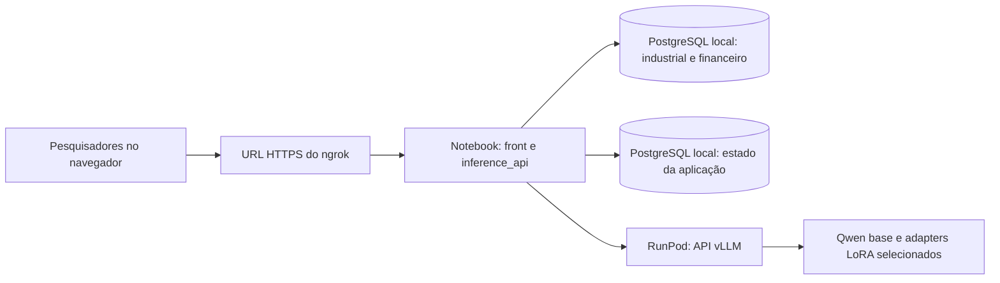

# Arquitetura da inferência compartilhada

**Estado em 14/10/2026:** arquitetura acordada, primeira API/front locais e cadeia determinística da SPEC-001 implementados em [`inference_api/`](../inference_api/README.md), com revisão independente aprovada para essa frente local. O esquema de `db_inference_app` foi criado e testado no cluster local isolado. O [DW local v1](../BancoModeloUse/dw/README.md) foi criado em outro banco, mas não está ligado à API. O serving com vLLM, o túnel ngrok e a validação compartilhada ainda não foram implementados. Este documento não comprova implantação ou teste remoto. A decisão original foi registrada no checkout `ba79b36`; as alterações atuais sobre `ad6edcb` ainda não foram commitadas.

## Objetivo e limites

Disponibilizar por uma sessão científica curta e compartilhada uma interface para editar prompts, escolher a LLM de inferência, ler respostas, inspecionar evidências e registrar verificações. A primeira implantação deve ser simples e de baixo custo: banco, backend e interface no notebook; GPU apenas na RunPod. O período de uso previsto é inferior a 24 horas, sem requisito de disponibilidade contínua.

O [protocolo de fine-tuning](../FineTuning/docs/protocol_v1.md), os [dados de origem](../BancoModeloUse/README.md), os [adapters e seus manifests](../FineTuning/docs/modelos_disponiveis.md) e os resultados já registrados permanecem preservados. O DW local v1 já foi implementado; sua integração ao backend e o harness formal por API continuam planejados e não são pré-requisitos implícitos para o primeiro serviço de inferência.

Para a comparação científica futura, a [arquitetura de avaliação](../BancoModeloUse/docs/arquitetura_avaliacao_modelos.md) distingue evidências fixas, iguais entre modelos, de pesquisa com tools. A [SPEC-007](../specs/active/SPEC-007/SPEC.md) prepara apenas a exportação local e reproduzível de evidências fixas a partir da DW. A API exploratória atual continua selecionando suas duas consultas por escopo declarado; escolha de tools pela LLM e pontuação formal ainda exigem contratos e implementação próprios.

## Topologia escolhida



O [mapa visual completo](assets/fluxo_arquitetura_pesquisa.png) também mostra
o DW local e distingue as ligações implementadas das previstas. O
[SVG editável](assets/fluxo_arquitetura_pesquisa.svg) preserva a fonte do desenho.

- O ngrok expõe **somente a aplicação HTTP** por uma URL HTTPS. O PostgreSQL permanece no loopback do notebook. A RunPod não precisa iniciar conexão com o notebook; o backend local faz chamadas de saída para a API do modelo. [Referência: túnel HTTP do ngrok](https://ngrok.com/use-cases/share-localhost).
- O front é servido pela mesma aplicação e pela mesma URL do ngrok. Ele chama apenas o backend local, sem receber credenciais da RunPod ou do PostgreSQL.
- O backend orquestra consultas permitidas e de leitura, monta um pacote de evidências e chama a LLM. A LLM não recebe acesso direto ao banco nem SQL arbitrário do navegador.
- O notebook, o cluster local, a aplicação, o túnel e o Pod precisam permanecer ativos durante o uso. Ao encerrar a sessão, o serviço de modelo pode ser parado para interromper o custo de GPU, observadas as regras de cobrança e armazenamento do provedor.

## Responsabilidades do código

| Frente | Responsabilidade e estado atual |
| --- | --- |
| [`BancoModeloUse/`](../BancoModeloUse/README.md) | Contém os CSVs preservados, modelos SQLAlchemy, importador e dois bancos locais `db_industrial` e `db_financeiro`. O [DW v1](../BancoModeloUse/dw/README.md) está em `db_pesquisa_dw`, separado das fontes e da aplicação. A API atual continua lendo diretamente os bancos de origem. |
| [`FineTuning/`](../FineTuning/AGENTS.md) | Continua sendo a fonte de verdade dos experimentos, configurações, adapters, manifests e resultados. Seus scripts de treino não serão executados para atender requisições do front. |
| [`runpod/`](../runpod/README.md) | Hoje contém scripts de preparação, treino e avaliação. A implementação futura de serving ficará em `runpod/serving/`, separada desses scripts, sem movê-los isoladamente. |
| [`inference_api/`](../inference_api/README.md) | Frente local implementada: HTTP, front simples, token de acesso, três escopos declarados sobre duas consultas fixas, bundle versionado, verificador exploratório, catálogo de aliases, cliente HTTP vLLM e histórico de prompts/execuções. Identidade individual, controles de uso e verificação científica seguem pendentes. |
| [Arquitetura da avaliação](../BancoModeloUse/docs/arquitetura_avaliacao_modelos.md) | Define perguntas, evidências, gold set e verificações científicas. O DW local v1 existe sob SPEC-006; integração e harness formal seguem pendentes. |

Estrutura atual e extensão prevista:

```text
inference_api/
  README.md
  web/                  # interface local inicial, servida pela API
  src/
    inference_api/      # HTTP, evidências, cliente vLLM, serviço e persistência
runpod/
  serving/              # previsto: inicialização e configuração do vLLM
```

O contrato HTTP e o esquema inicial estão descritos no [README da API](../inference_api/README.md). Não criar diretórios vazios nem reaproveitar o antigo RAG/agentes retirado do checkout. O importador atual aceita apenas o cluster isolado em `127.0.0.1:5544`; a aplicação nova exige essa configuração explícita e não usa os valores padrão `localhost:5432` de [`database_config.py`](../BancoModeloUse/infrastructure/config/database_config.py). A conexão falha se a configuração estiver ausente.

## Modelos na RunPod e troca pelo front

Os pesos disponíveis no checkout são adapters PEFT/LoRA, não cópias completas da LLM. O [catálogo de modelos](../FineTuning/docs/modelos_disponiveis.md) identifica a base `Qwen/Qwen2.5-7B-Instruct`, os seis adapters locais, suas runs e seus manifests. A versão exata dos pesos da base ainda não está fixada por hash nesse catálogo. Antes de servir, registrar a revisão efetivamente obtida da base e conferir os arquivos dos adapters escolhidos.

Na primeira configuração de serving, o vLLM deve iniciar com a base e registrar os adapters selecionados sob aliases estáveis. O backend mantém uma lista de modelos **realmente disponíveis** e a confirma contra a API do servidor. Ao clicar em outro modelo fine-tunado, o front muda o alias enviado na próxima requisição; não reinicia o Pod nem altera a escolha dos demais usuários. O vLLM permite selecionar o adapter LoRA pelo campo `model` de cada requisição e atender chamadas concorrentes conforme sua configuração e a memória da GPU. A capacidade concreta ainda requer teste no Pod escolhido. [Referência: serving LoRA do vLLM](https://docs.vllm.ai/en/stable/features/lora/).

A primeira implementação deve registrar os adapters autorizados na inicialização. O carregamento dinâmico de novos adapters por endpoint administrativo fica fora do fluxo inicial, pois o próprio vLLM aponta riscos de segurança nessa função. Uma LLM com outra base de pesos pode exigir outro processo ou endpoint; nesse caso, o backend roteará pelo catálogo, e o custo/capacidade devem ser avaliados antes de disponibilizá-la no seletor.

## Front e histórico compartilhado

O front inicial permite editar o prompt, selecionar um alias disponível, ajustar temperatura e limite de tokens, executar perguntas e inspecionar o histórico. A comparação lado a lado e a edição de critérios exploratórios de verificação ainda faltam; quando implementadas, a versão dos critérios usada deverá ficar registrada em cada execução. A interface mostra as consultas e evidências efetivamente usadas, limites e falhas. Não deve apresentar uma resposta como cientificamente validada apenas porque o modelo respondeu ou porque uma checagem parcial passou.

Cada salvamento de prompt cria uma **nova revisão**; cada execução guarda um snapshot imutável, mesmo quando partiu de um rascunho ainda não salvo. No mínimo, o registro deve identificar autor, data, versão do prompt e seu texto exato, modelo/endpoint/adapter e versões, parâmetros, pergunta, rota, consultas, evidências com origem e período, resposta, verificações, feedback humano e estado de erro. A escolha do modelo pertence à execução de cada usuário, não a uma configuração global que outro usuário possa sobrescrever. A interface pode mostrar diferenças entre revisões e respostas lado a lado.

O armazenamento editável da aplicação usa um banco local próprio, `db_inference_app`, no mesmo cluster PostgreSQL. O comando `init-db` cria o esquema inicial de revisões, execuções e feedback; o início da API não altera o esquema. Os bancos de origem industrial e financeiro são consultados em transações somente leitura, por SQL fixo. A política de migração e retenção ainda não foi implementada. Dados congelados, adapters, manifests e resultados brutos existentes não são editados pelo front.

Experimentos livres no front e avaliação formal têm estados distintos. Uma comparação científica exigirá um caso e protocolo versionados, mesmo recorte de dados e contexto, parâmetros declarados e verificações apropriadas. O gold set e os critérios oficiais de avaliação ficam fora do contexto entregue à LLM. A [arquitetura de avaliação](../BancoModeloUse/docs/arquitetura_avaliacao_modelos.md) continua sendo a fonte dessa separação.

## Contratos: primeira fatia e pendências

1. **Entrada e saída HTTP:** implementadas para pergunta, revisão ou rascunho, alias, parâmetros e snapshot com evidência, resposta, estado e erro. A API não aceita SQL livre. Veja o [contrato executável](../inference_api/README.md).
2. **Pacote de evidências:** contrato exploratório `schema_version: 2` para escopos declarados financeiro, industrial e integrado. A rota integrada reúne duas agregações anuais de fontes distintas, com aviso de associação sem causalidade. O verificador confere estrutura e citações; validação científica continua fora da API. Snapshots da primeira fatia (`schema_version: 1`) permanecem legíveis.
3. **Catálogo de modelos:** sete aliases candidatos e consulta de disponibilidade em `/v1/models` implementados. Endpoint, revisão da base, hash do adapter, run e janela efetivamente servidos ainda precisam ser fixados e conferidos no Pod. Segredos ficam apenas no backend, fora do Git.
4. **Persistência e concorrência:** esquema inicial de revisões de prompt, snapshots de execução e feedback implementado, com conflito por revisão esperada. Identidade de autor é declarada; migrações e retenção ainda faltam.
5. **Acesso compartilhado:** token simples protege a API local, mas não autentica cada pesquisador individualmente. Antes de abrir ngrok, implementar autenticação/autorização por usuário, limites de uso e proteção verificada do endpoint da RunPod. A chave nativa do vLLM não protege todos os seus endpoints; não depender somente dela ao expor o serviço. [Referência: segurança do vLLM](https://docs.vllm.ai/en/stable/serving/online_serving/openai_compatible_server/).
6. **Capacidade e operação:** GPU/VRAM, quantização, quantidade de adapters simultâneos, concorrência, streaming se necessário, comandos verificados de iniciar/parar e teste de ponta a ponta continuam pendentes. A escolha concreta do Pod e seu custo não ficam fixados neste documento.

## Evidência e manutenção

Antes de dizer que o serviço está pronto, verificar separadamente: carga da base e dos adapters com seus identificadores; resposta da API do vLLM; consultas de leitura aos dois bancos locais; persistência de revisões e execuções; front pela URL do ngrok; autenticação; e uma execução ponta a ponta com proveniência legível. Um teste local ou um manifest com estado `completed` não equivale a essa validação.

Atualizar este documento e os README das frentes afetadas na mesma mudança que alterar topologia, contratos ou comandos. Marcar decisões propostas e partes ainda não implementadas; registrar data/commit e evidência para afirmações que envelhecem. Remover instruções e código comprovadamente fora de uso após conferir consumidores, preservando dados e resultados protegidos conforme o [AGENTS.md da raiz](../AGENTS.md).
