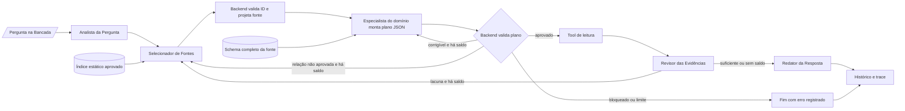

# SPEC-013 — consulta construída pelo Especialista

Contrato 3, decisão do pesquisador em 06/11/2026. Ordem de execução autorizada:
diagrama, documentação e somente depois código. Esta revisão substitui o
Planejador separado e as duas chamadas de descoberta dos contratos anteriores.
Os recibos, dados, resultados brutos e gabaritos aprovados não são alterados.

## Fluxo e responsabilidades



O Selecionador escolhe a fonte por necessidade, grão e cobertura. O backend
monta o índice sem LLM e entrega integralmente o contrato da fonte escolhida.
O Especialista dos Dados Consolidados, Industriais ou Financeiros é o papel
`especialista_consulta`, identificado também por `domain` na entrada. Ele
escolhe campos e filtros e produz o plano. Não executa SQL diretamente.
Todos os papéis usam o mesmo modelo candidato. Uma consulta sem correção
requer cinco chamadas: Analista, Selecionador, Especialista, Revisor e Redator.
Uma nova rodada acrescenta Selecionador, Especialista e Revisor.

## Contexto e contratos JSON

| Papel | Entrada | Saída e tarefa |
| --- | --- | --- |
| Analista | `question`, `domain_index`, `protocol` | `tratavel`, `necessidade`, `dominios`, `lacunas`; decompor o pedido. |
| Selecionador | `question`, `necessidade`, `source_index`, `available_source_ids`, `evidence_state`, `gap`, `limits` | `decisao`, `fonte_id`, `dominio_adicional`, `map_refs`, `justificativa`; escolher primeira/próxima fonte ou pedir domínio adicional. `map_refs` contém somente IDs do índice. |
| Especialista | `question`, `necessidade`, `domain`, `rota`, `source_contract`, `evidence_state`, `gap`, `available_evidence_ids`, `limits` | `plano`, `justificativa`, `evidence_refs`; construir a consulta usando o schema recebido. |
| Revisor | Pergunta, necessidade, domínios, resultado atual, evidências anteriores e saldo | Suficiência, conflito ou lacuna com próximo dado e domínio. |
| Redator | Pergunta, evidências aceitas, IDs, erros e limites | Resposta, referências, cálculos e ressalvas; sem gabarito. |

`source_contract` preserva todos os metadados aprovados disponíveis: campos,
tipos SQL, chaves, relações, unidades, grão, cobertura e filtros. Acrescenta
`filter_contracts`, um JSON Schema de filtros derivado das regras executáveis
do serviço, sem alterar o arquivo de catálogo aprovado. Tipos desconhecidos
não são inferidos pelo modelo nem inventados pelo backend.
O consumidor sintético usa `fixture-2`, com tipos e JSON Schema de filtros
explícitos; intervalos financeiros também usam `from`/`to`. Snapshots antigos
mantêm a gramática que registraram, sem reescrita ou replay automático.

Exemplo resumido de entrada do Especialista industrial (os campos e os tipos
completos da fonte são entregues no payload real):

```json
{
  "question": "Quais paradas geradas da máquina 2000002 ocorreram em 2021?",
  "domain": "industrial",
  "source_contract": {
    "source_id": "paradas_maquinas_geradas",
    "filter_contracts": {
      "type": "object", "minProperties": 1, "additionalProperties": false,
      "properties": {
        "maquina_id": {"type": "integer", "minimum": 1},
        "hora_inicio_parada": {
          "type": "object", "required": ["from", "to"],
          "additionalProperties": false,
          "properties": {"from": {"type": "string"}, "to": {"type": "string"}},
          "description": "ISO-8601; início inclusivo, fim exclusivo; from < to"
        }
      }
    }
  }
}
```

Saída (plano tipado, sem SQL):

```json
{
  "plano": {
    "fonte_id": "paradas_maquinas_geradas",
    "campos": ["parada_id", "maquina_id", "hora_inicio_parada"],
    "filtros": {"maquina_id": 2000002, "hora_inicio_parada": {"from": "2021-01-01", "to": "2022-01-01"}},
    "limite": 20, "grao": "parada_id/source_period"
  },
  "justificativa": "Eventos da máquina no período pedido.",
  "evidence_refs": []
}
```

O envelope comum mantém identidade do papel, rodada, call_id, versões e IDs
de dependências. O backend valida cada saída antes de avançar. Os schemas
executáveis de entrada e saída são as fontes de verdade do formato completo;
os exemplos no diagrama são explicitamente compactos. Não é solicitado nem
armazenado raciocínio privado: justificativas e decisões são observáveis.

## Correção, orçamento e encerramento

- Saída JSON inválida volta ao mesmo papel com `rejected_output`,
  `rejected_event_id`, erro, tentativa, tentativas restantes e saldo atual.
- Consulta recusada corrigível volta ao mesmo Especialista com
  `rejected_plan`, evento da tool, erro e saldo atualizado. A entrada original,
  a pergunta e o contrato completo permanecem disponíveis.
- Relação não aprovada volta ao Selecionador sob limite; o backend não troca
  campos, filtros ou fontes para conseguir executar.
- Cada tentativa no serviço consome o orçamento, inclusive as recusadas.
  Os limites existentes de chamadas, consultas, linhas e bytes continuam.
  Falha de acesso, divergência de dados, limite de resultado ou erro de
  provedor encerra explicitamente; não há repetição automática externa.
- Resultado vazio vai ao Revisor. Lacuna com saldo volta ao Selecionador;
  sem saldo segue à resposta parcial. Não se transforma ausência em zero.

## Aceitação desta alteração

### Correções de rastreabilidade e apresentação — 06/11/2026

`source_event_ids` deve listar as dependências diretas efetivamente entregues
à chamada, sem janela dos últimos eventos. Inclui o Analista quando sua saída
é usada, a seleção/projeção da fonte, todas as tools cujas evidências estão na
entrada, o evento que produziu a lacuna/decisão e a tentativa recusada recebida
como feedback. A ordem é a do trace, sem duplicatas, referências futuras ou IDs
inexistentes. Não significa acesso ao trace completo nem raciocínio privado.
Projeções e consultas também registram seus produtores em `source_event_ids`
no evento, mantendo intacto o plano enviado ao executor. A política nova é
identificada no resultado; snapshots anteriores não são reescritos.

A resposta final da Bancada deve mostrar texto, ressalvas, cálculos registrados
e referências das evidências, inclusive ao reabrir o histórico. Todas as tentativas
do Redator devem continuar acessíveis, com erro e recuperação. Snapshots antigos
sem esses campos continuam legíveis, sem inventar ressalvas ou referências.

Validar regressões de três fontes, ausência de fonte, descoberta de domínio,
correção de contrato/consulta e Redator, preservação dos snapshots e renderização
das ressalvas/referências. Estas correções cumprem o fluxo existente do diagrama,
sem alterar papéis, gatilhos ou a modelagem dos bancos. Validação local e replay
não contam como nova inferência real nem avaliação científica.

Verificar com fixtures: ordem dos cinco papéis; três domínios; fonte de detalhe
como primeira consulta; escopo de mapa por fonte; tipos/filtros preservados;
retorno de erro com plano recusado e saldo; orçamento incluindo recusas;
aprofundamento; referências válidas; ausência dos papéis antigos em runs novos;
leitura dos traces antigos na UI. Rodar testes backend, frontend e validadores
de SPEC aplicáveis. Não alterar casos/gabaritos nem chamar provedores nesta
alteração. Evidência local não comprova qualidade científica nem nova cadeia
real pela Bancada. SPEC permanece `in_progress` até os gates de engenharia
e auditoria independente; a adjudicação científica é posterior.

Diagrama: página `rC3Onoxkcgc0oOyFh0Ck` do arquivo indicado pelo pesquisador;
fluxo geral, fluxo interno, fichas JSON e exemplo lateral. A página do DER não
é alterada. Snapshot editável em
`evidence/specialist-owned-query-flow-2026-11-06.drawio`.
